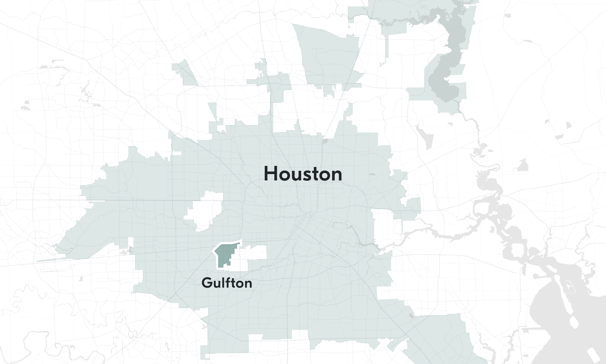
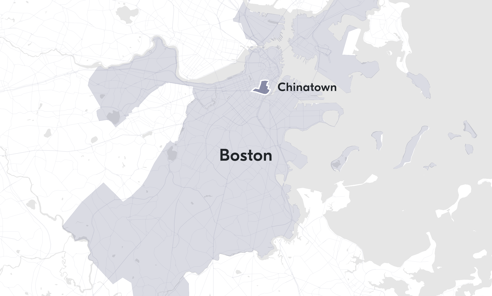

Accounting for , immigrants play a significant role in the U.S. housing market. Yet, we know relatively little about this population’s rental housing experiences, including their risk of eviction. In a research article published in the journal , we take a closer look at the neighborhoods where immigrants live and have historically depended on for support. Analyzing data between 2012 and 2016, we find that poor immigrant neighborhoods nationwide have an eviction rate 26 percent lower than similar non-immigrant neighborhoods. 



 This is surprising because earlier research has shown that evictions are generally high in neighborhoods with concentrated  and , characteristics also common in these communities. Furthermore, immigrants not only face rising costs and a growing shortage of affordable homes, like millions of others across the country do, they often also contend with additional barriers in the housing market, from discrimination in rental applications to heightened immigration enforcement. Relatively lower eviction rates in immigrant neighborhoods are therefore all the more unexpected.

 

To understand what is behind this pattern, we visited two immigrant neighborhoods—Gulfton in Houston and Chinatown in Boston—and spoke with ninety renters, landlords, and community members about their housing experience. While low rents (and flexibility from property managers) partially explain low eviction rates in each neighborhood, these conditions result from very different housing dynamics. Immigrant renters in Gulfton maintain low rents by making trade-offs in housing conditions, while residents in Chinatown benefit from housing that co-ethnic landlords and community organizations have kept relatively affordable.

<table class="bar-table">
  <thead>
    <tr>
      <th></th>
      <th>Eviction judgment rate*</th>
      <th>Eviction filing rate*</th>
      <th>Poverty rate*</th>
      <th>% Foreign- born*</th>
      <th>Median rent†</th>
    </tr>
  </thead>
  <tbody>
    <tr><td class="city" colspan="6">Boston</td></tr>
    <tr class="hl">
      <td class="area">Chinatown</td>
      <td>0.6<i style="width:15%"></i></td>
      <td>1.5<i style="width:20%"></i></td>
      <td>23.8<i style="width:59%"></i></td>
      <td>51.1<i style="width:84%"></i></td>
      <td>$1,082<i style="width:72%"></i></td>
    </tr>
    <tr class="group-end">
      <td class="area">Metrowide</td>
      <td>1.5<i style="width:38%"></i></td>
      <td>3.1<i style="width:40%"></i></td>
      <td>10.2<i style="width:25%"></i></td>
      <td>17.7<i style="width:29%"></i></td>
      <td>$1,440<i style="width:95%"></i></td>
    </tr>
    <tr><td class="city" colspan="6">Houston</td></tr>
    <tr class="hl">
      <td class="area">Gulfton</td>
      <td>1.6<i style="width:40%"></i></td>
      <td>4.1<i style="width:53%"></i></td>
      <td>38.4<i style="width:95%"></i></td>
      <td>57.8<i style="width:95%"></i></td>
      <td>$818<i style="width:54%"></i></td>
    </tr>
    <tr class="bottom-row">
      <td class="area">Metrowide</td>
      <td>3.8<i style="width:95%"></i></td>
      <td>7.3<i style="width:95%"></i></td>
      <td>15.3<i style="width:38%"></i></td>
      <td>22.9<i style="width:38%"></i></td>
      <td>$1,092<i style="width:72%"></i></td>
    </tr>
  </tbody>
  <tfoot>
    <tr><td colspan="6">*Based on 2012–2016 Eviction Lab data (Original version) and ACS 5-Year estimates. For more recent data on these cities, visit Eviction Lab’s . †Based on 2015–2019 ACS 5-Year estimates.</td></tr>
  </tfoot>
</table>

In Houston, Gulfton is home to immigrants and refugees from Mexico and Central America and, increasingly, Africa and the Middle East. Large apartment complexes there form one of the densest zip codes in the city. Targeting the city’s growing immigrant population, corporate landlords and outside investors rent these apartments out for cheap, while minimizing investment in upkeep or maintenance.

This lack of investment is reflected in the broken windows, car-sized potholes, and unkempt courtyards in the properties we visited. Inside the apartments, residents deal with mold, water leaks, broken air conditioners and refrigerators, and pests, issues property managers are slow to address. Frustrated, one respondent felt like “they [we]re treating us like animals.” But poor housing conditions were not the only trade-off; some families further minimize housing costs by crowding in smaller units. For example, one undocumented couple and their five young children crammed into a one-bedroom apartment, while transforming the closet into a bed for their oldest son. In the face of more expensive housing options outside of Gulfton, renters feel they have little choice but to endure these poor conditions. 

When tenants do fall behind on rent, some Hispanic property managers occasionally offer arrangements like payment plans. Nonetheless, tenants emphasize that paying rent is the most urgent among their expenses: “My house comes first … I can be without a phone, I can manage without a car, but I have to pay the rent.” 

1,600 miles away, in Boston’s Chinatown, immigrants also do as much as they can to avoid an eviction. However, they further benefit from co-ethnic housing resources that are not available in Gulfton. They have access to a network of landlords in Chinatown—one stemming from a long history of Chinese settlement in this neighborhood since the early twentieth century—that has helped maintain local housing affordability.



At the time of our research, , a much higher level than in Boston as a whole. This unusually large stock of subsidized housing was developed by local community organizations that explicitly prioritize affordable rents for residents and maintain Chinatown’s ethnic and working-class character. 

Subsidized units are not the only source of affordable housing. Co-ethnic landlords embedded in the community intentionally keep rents low. Familiar with their tenants (and sometimes their tenants’ employers), these landlords offer informal arrangements and flexibility not always made available by corporate landlords. One set of landlords distinctive to Chinatown are family associations, longstanding organizations in American Chinatowns arranged around people with shared surnames or hometowns. These organizations formed historically to help Chinese immigrants, who faced discrimination and language barriers, and provide them with jobs, social services, and even housing. As landlords, family associations stand out for their democratic rent-setting practices. Members of these organizations, who pool money and collectively own properties in Chinatown, vote on rent increases, meaning units often end up renting at below-market rates. 



Taken together, Chinatown offers a model of local ownership arrangements that have staved off displacement pressures. Far from naturally occurring, affordable housing in Chinatown is a result of local, intentional effort. It also demonstrates the significance of place-based housing investment for neighborhood stability. 

Neighborhoods like Chinatown may play an ever-more important role for immigrants in today’s political climate. The recent restrictive turn in federal immigration policy has eroded immigrants’ ability , , and . That precarity has extended to and . The case of Gulfton highlights that most immigrant communities do not have access to resources like those in Chinatown, but have to tolerate poor and crowded housing conditions. To build thriving immigrant communities, policymakers should provide housing resources that guarantee affordability without compromising quality. Supporting communities already rooted in these neighborhoods, while strengthening local institutions, is one great way to do this.